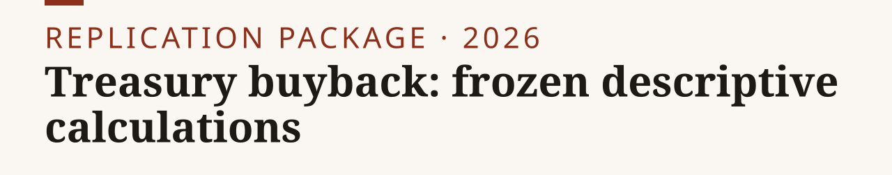

<p><picture><source media="(prefers-color-scheme: dark)" srcset="assets/banner-dark.svg"></picture></p>

**Treasury bought back $15.265bn of long-term debt at gross accepted par between September 10 and October 1, 2026; the calculations here describe that and do not identify an effect on yields.**

[Paper](https://nikkhosravipour.com/post/treasury-buyback) · [Data](#data-availability) · [Site](https://nikkhosravipour.com)

[](LICENSE) [](LICENSE-docs) [](https://www.r-project.org/)

> [!NOTE]
> Runs in seconds from frozen inputs. Needs R 4.0 or newer and `jsonlite`; no API key or network access. Input vintage: collected 2026-10-06. This release ships no charts.

The note's calculations are reproduced from frozen inputs: three gross long-nominal accepted purchases, two ten-common-date US-minus-Japan 30y-minus-10y slope averages, a benchmark modified-duration calculation, and a policy-statement receipt. This repository omits the historical capacity scenario, charts, rejected drafts, research notes, private tooling, credentials, and the live data pipeline.

## Quick start

1. Clone: `git clone https://github.com/nik110403/treasury-buyback-note.git && cd treasury-buyback-note`
2. Install the one dependency: `Rscript -e 'install.packages("jsonlite")'`
3. Replay and check:

```sh
Rscript R/replay_frozen.R
sha256sum -c SHA256SUMS
```

The replay parses frozen raw inputs in memory and asserts: $15.265bn gross accepted par across Sep 10, Sep 24, and Oct 1; -63.24bp and -71.33bp averages; -8.09bp change; 7.851538709 modified duration; and .546807627-.911346045bp arithmetic under the stated illustration. The November 4 endpoint is not present and remains pending.

## Scope and limits

The $15.265bn is gross accepted par, not net duration removal. The 9-15 year duration range and 25bp per roughly $800bn 10-year-equivalent factor are analyst assumptions/illustrative arithmetic, not measured security duration, cash paid, funding replacement, an ATI-estimated universal DV01 coefficient, a causal effect, or an upper bound. The slope comparison does not identify a buyback effect, exclude anticipated purchases or other channels, measure liquidity effects, or prove a 30-year real term-premium mechanism. The September 16 policy hike fails the original unchanged-policy condition.

## Exhibit map

This release has no figures or tables. `docs/CLAIMS.md` maps each retained statement to its inputs and result.

| Retained statement | Input | Result |
|---|---|---|
| Gross long-nominal purchases, Sep 10 to Oct 1 | `inputs/treasury/buybacks_operations.json` | $15.265bn |
| US-minus-Japan 30y-minus-10y slope averages | `inputs/fred/`, `inputs/japan/` | -63.24bp to -71.33bp, change -8.09bp |
| Benchmark duration and scale | assumptions in `R/replay_frozen.R` | 7.851538709; .546807627-.911346045bp |
| Policy condition | `inputs/policy/fed-2026-09-16-statement-excerpt.txt` | Sep 16 hike of 25bp; unchanged-policy condition failed |

## Data availability

| Dataset | Source | Access | Included |
|---|---|---|---|
| Buyback operations | U.S. Treasury Fiscal Data, archived 2026-10-06 | Public, reuse permitted | `inputs/treasury/` |
| DGS10, DGS30 | Federal Reserve Board H.15 via FRED, vintage 2026-10-06 | Public domain, citation requested | `inputs/fred/` |
| JGB yield CSVs | Japan Ministry of Finance, archived 2026-10-06 | PDL 1.0, citation required | `inputs/japan/` |
| FOMC statement excerpt | Federal Reserve Board, 2026-09-16 | Public domain, citation requested | `inputs/policy/` |

`docs/PROVENANCE.md` has the source status, quoted provider terms, required attributions, and redistribution conclusions. Third-party data is not under any code license of this tree.

## Repository layout

```text
treasury-buyback-note/
├── R/replay_frozen.R   # offline replay and assertions
├── inputs/             # frozen third-party inputs
├── docs/               # CLAIMS.md, PROVENANCE.md
├── assets/             # banner and social preview (made by tools/banner)
├── tools/banner/       # banner generator
├── SHA256SUMS
├── CITATION.cff
├── LICENSE
└── LICENSE-docs
```

## Citation

GitHub shows a "Cite this repository" button from `CITATION.cff`. BibTeX:

<details>
<summary>BibTeX</summary>

```bibtex
@misc{treasury_buyback_note2026,
  author = {Khosravipour, Nik},
  title  = {Treasury buyback: frozen descriptive calculations},
  year   = {2026},
  url    = {https://github.com/nik110403/treasury-buyback-note}
}
```

</details>

## License

Code: [MIT](LICENSE). Text: [CC BY 4.0](LICENSE-docs). Third-party data is not under the MIT licence or CC BY 4.0; see `docs/PROVENANCE.md`.
